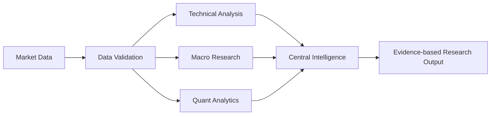

<div align="center">


# MARKET-MIND-AI

### Open-source • Node-based • Multi-asset market intelligence

A visual research environment where specialist analytical workers connect as reusable nodes, execute directed workflows, and produce traceable research outputs.

[Four-Market Architecture](docs/FOUR-MARKET-PLATFORM.md) · [Architecture](docs/ARCHITECTURE.md) · [Workflow Guide](docs/WORKFLOW-GUIDE.md) · [Market Coverage](docs/MARKET-COVERAGE.md) · [Roadmap](docs/ROADMAP.md) · [Development Guide](docs/DEVELOPMENT.md) · [Private Deployment](docs/PRODUCTION-DEPLOYMENT.md)

</div>

---

## Overview

MARKET-MIND-AI is an open-source financial research terminal inspired by professional market-data workstations and visual node editors. Its core interaction model is a connected graph: data sources, validation steps, analytical workers, quantitative methods, and research outputs are composed into reusable workflows.

The platform is designed for research across four primary market groups: India, US, crypto and forex, with shared multi-asset infrastructure for equities, ETFs, indices, commodities, fixed income and macroeconomic series. Actual coverage depends on configured providers, venue permissions and licensing terms. See the [four-market implementation blueprint](docs/FOUR-MARKET-PLATFORM.md).

> **Preview notice:** The image above is a conceptual product illustration showing the intended terminal direction. It is not a screenshot of a fully implemented production application and does not display live market data.

## Product principles

- **Composable intelligence:** specialist workers connect through explicit input/output contracts.
- **One central intelligence core:** workers are analytical modules, not hundreds of separate language models.
- **Evidence-first outputs:** calculations, source timestamps, data quality, caveats, and method versions should be inspectable.
- **Deterministic analytics:** numerical calculations are performed by tested code; language models may explain, summarize, and route research.
- **Governed improvement:** worker changes are tested, versioned, reviewed, and reversible.
- **Provider-neutral data layer:** connectors are modular and must respect provider terms, licences, rate limits, and redistribution rules.
- **Synthetic data is labelled:** the sample endpoint is a deterministic development fixture, never a live or historical price feed.
- **Research only:** no paper trading, brokerage credentials, order routing, or automated execution.

## Cross-market collaboration API

- `GET /api/agent-network` — inspect the four-market research mesh.
- `POST /api/agent-network/messages` — publish structured, source-linked research notes.
- `GET /api/agent-network/messages` — read shared notes across markets or filter by market/topic.
- `GET /api/agent-network/brief` — build a deterministic cross-market roundtable with per-market coverage, quality labels and comparable structured findings.

Specialist modules exchange deterministic records; this does not activate LLM agents, live feeds or trading execution. See [four-market architecture](docs/FOUR-MARKET-PLATFORM.md).

## Current implementation

| Area | Current state |
|---|---|
| React + TypeScript terminal shell | Implemented |
| React Flow node graph | Implemented |
| Node library and worker catalogue UI | Implemented |
| FastAPI service and health endpoint | Implemented |
| DAG workflow execution and cycle detection | Implemented |
| Data, SMA, EMA, RSI, MACD, Bollinger, returns, volatility and summary nodes | Implemented |
| 550 worker profiles / 20 departments | Generated templates; not 550 completed agents |
| Cross-market research agent message bus | Added; deterministic shared mesh across India, US, crypto and forex; no model inference or live feeds |
| Docker Compose development setup | Added |
| CI quality workflow | Added; run status visible in GitHub Actions |
| Market taxonomy and searchable instrument reference directory | Added |
| Configurable RSS news ingestion and terminal news panel | Added |
| SMA, EMA, RSI, MACD, Bollinger and realized-volatility library | Added |
| Async in-process event bus and latency architecture | Added |
| Normalized OHLCV contract, timezone validation, provider adapter protocol and synthetic fixture | Added |
| SQLite market-bar history with idempotent upserts and provenance retention | Added |
| User-defined educational setup geometry and risk/reward calculator | Added; no signal generation or execution |
| Deterministic descriptive chart report over stored OHLCV | Added; SMA, RSI, MACD, Bollinger, ATR, recent range references, rule-based candle labels and confirmed swing points |\n| Integrated deep research and OHLCV quality diagnostics | Added; per-timeframe chart research, duplicate/order/OHLC/volume checks, source/status counts and explicit diagnostic limitations |\n| Advanced market diagnostics | Added; relative volume, per-observation return volatility, descriptive volatility bands and historical close-to-close drawdown |\n| Cross-asset historical correlation | Added; Pearson correlation of timestamp-aligned close-to-close returns, paired sample counts and null handling for insufficient/constant series |\n| Historical price-level clusters | Added; repeated confirmed swing highs/lows grouped by configurable percentage tolerance and minimum touch count |\n| Historical market breadth | Added; timestamp-aligned advancing/declining/unchanged counts, percentages, net advances and symbol coverage |\n| Consolidated research dashboard | Added; timeframe summaries, data-quality counts, price-cluster counts, optional correlation and latest breadth summary |
| Interactive sample-series chart using Lightweight Charts | Added |
| Workflow diagrams and graph usage guide | Added |
| Unit tests for branching DAG execution and cycle rejection | Added |

## Shared agent skill playbooks

Ten upstream day-trader skill definitions are vendored under [`.agents/skills/day-trader-skill/`](.agents/skills/day-trader-skill/README.md). The 550 worker profiles now carry department-based `skill_refs` so the orchestration layer can select relevant research guidance without injecting every playbook into every task. These profiles remain templates, not 550 active agents. Skill references do not execute scripts or grant permissions. The broker/order-execution skill is excluded; the application remains research-only with no brokerage routing.

## Visual workflow model



Workers are intended to be independently inspectable and reusable. The graph engine executes supported nodes in topological order and rejects cyclic or unsupported workflows.

## System flow diagrams

### End-to-end research pipeline


### Specialist worker network


### Low-latency engineering model


More detail: [workflow guide](docs/WORKFLOW-GUIDE.md), [low-latency architecture](docs/LOW-LATENCY-ARCHITECTURE.md), and [algorithm catalogue](docs/ALGORITHMS.md).

## Run locally

### Requirements

- Docker and Docker Compose, or
- Python 3.11+ and Node.js 20+

### Docker Compose

```bash
git clone https://github.com/djny45/-MARKET-MIND-AI.git
cd ./-MARKET-MIND-AI
docker compose up --build
```

Open:
- **Terminal:** http://localhost:5173
- **API documentation:** http://localhost:8000/docs
- **Health check:** http://localhost:8000/api/health

For manual setup, see [docs/DEVELOPMENT.md](docs/DEVELOPMENT.md).

## API surface

| Method | Endpoint | Purpose |
|---|---|---|
| GET | `/api/health` | Service health and execution boundary |
| GET | `/api/ready` | SQLite dependency readiness; HTTP 503 when unavailable |
| GET | `/api/providers/status` | Implemented adapter availability; distinguishes synthetic fixture from live providers |
| GET | `/api/audit/events` | Recent market-data ingestion audit events |
| GET | `/api/market-data/lineage` | Stored observation counts and timestamp ranges by source and status |
| GET | `/api/market-data/overview` | Local stored symbol/timeframe coverage summary |
| GET | `/api/watchlist` | List locally saved instrument symbols |
| POST | `/api/watchlist` | Add an instrument symbol to the local watchlist |
| DELETE | `/api/watchlist/{symbol}` | Remove an instrument from the local watchlist |
| GET | `/api/nodes` | Supported workflow node definitions |
| GET | `/api/workers` | Worker profile catalogue |
| GET | `/api/instruments?q=` | Search curated instrument examples by market group and asset class |\n| GET | `/api/instrument-master` | Search persistent four-market instrument reference metadata |\n| POST | `/api/instrument-master/identifiers` | Register provider-native identifiers against canonical instrument IDs |
| GET | `/api/news` | Fetch configured official RSS headlines |
| POST | `/api/news/ingest` | Trigger RSS ingestion |
| POST | `/api/indicators` | Calculate deterministic indicator series |
| POST | `/api/research/setup` | Calculate hypothetical entry/stop/target geometry and risk/reward from user-supplied levels |
| POST | `/api/analytics/performance` | Historical return, drawdown, volatility, Sharpe, Sortino and optional benchmark statistics |
| GET | `/api/market-data/sample` | Explicitly synthetic OHLCV fixture for UI and integration tests |
| POST | `/api/market-data/store` | Store normalized bars with source, status and retrieval metadata |\n| POST | `/api/market-data/events` | Import validated historical trades, quotes, order-book snapshots, open interest, funding and FX reference events |\n| GET | `/api/market-data/events` | Query historical microstructure events by instrument, event type, provider, venue and time range |
| GET | `/api/market-data/events/quality` | Diagnose historical event sequence, timestamp and order-book snapshot consistency |
| GET | `/api/market-data/history` | Retrieve stored bars with provenance metadata |
| GET | `/api/research/chart` | Single-timeframe descriptive report from stored bars |
| GET | `/api/research/timeframes` | Optional multi-timeframe comparison across stored 15m, 1h, 4h and 1d bars |
| GET | `/api/research/export` | Download provenance-preserving historical evidence JSON with SHA-256 integrity metadata |
| POST | `/api/research/compare-exports` | Compare two compatible historical evidence bundles |\n\nDeep terminal report (single or multi-timeframe):\n\n```bash\ncd backend\nPYTHONPATH=. python terminal_chart_report.py --symbol BTCUSD --mode single --interval 1h --limit 500 --deep\nPYTHONPATH=. python terminal_chart_report.py --symbol BTCUSD --mode multi --intervals 15m,1h,4h,1d --limit 500 --deep\nPYTHONPATH=. python terminal_chart_report.py --symbol BTCUSD --mode single --interval 1h --limit 500 --deep --correlate-symbols ETHUSD,SOLUSD\nPYTHONPATH=. python terminal_chart_report.py --symbol BTCUSD --mode single --interval 1h --limit 500 --deep --breadth-symbols ETHUSD,SOLUSD\n```\n\nThe deep report adds structural data-quality diagnostics, optional cross-asset correlation and market-breadth summaries from exact timestamp matches, and a consolidated `dashboard` summary. It does not infer freshness or missing exchange sessions without provider-specific schedules. See [deep analysis guide](docs/DEEP-ANALYSIS.md).
| POST | `/api/research/orchestrate` | Aggregate specialist findings with explicit market coverage, evidence quality and disagreement reporting |\n| POST | `/api/workflows/execute` | Execute a directed research graph |

## Repository structure

```text
.
├── .github/workflows/       # CI quality checks
├── backend/app/             # FastAPI and DAG execution engine
├── frontend/src/            # React terminal and graph editor
├── docs/                    # Architecture, roadmap, development guide
│   └── assets/              # Project visual assets
├── docker-compose.yml
└── README.md
```

## Roadmap

1. Harden graph contracts, validation, test coverage, and saved workflows.
2. Add licensed market-data adapters, symbol/reference-data services, and streaming status.
3. Build multi-panel charts, screeners, heatmaps, fundamentals, news, and macro workspaces.
4. Expand deterministic analytics and implement specialist workers with measurable evaluations.
5. Add central AI research orchestration, reviewed worker memory, audit trails, and production observability.

See the detailed [roadmap](docs/ROADMAP.md).

## Data and licensing

This repository does not include Bloomberg proprietary software, terminal code, market datasets, or proprietary content. Data adapters must use authorized sources and clearly label real-time, delayed, end-of-day, and historical data. A publicly accessible endpoint is not automatically licensed for commercial use or redistribution.

Third-party libraries must be reviewed for licence compatibility, attribution, security, and maintenance before adoption.

## Security

Do not commit API keys, tokens, broker credentials, or private datasets. Use environment variables or a managed secret store. Report security issues privately using [SECURITY.md](SECURITY.md).

## Disclaimer

MARKET-MIND-AI is a software and financial-information research project, not a broker, exchange, investment adviser, or execution platform. Outputs may be incomplete, delayed, or inaccurate and are not personalized investment recommendations. Historical analysis does not guarantee future results.

## Contributing

Contributions are welcome. Please read [CONTRIBUTING.md](CONTRIBUTING.md), open an issue for substantial changes, add tests, and document data-source and licence implications.

<div align="center">

**Built as an open-source research platform.**

</div>


## Research evidence export and verification

The Research dashboard can download a provenance-preserving JSON bundle from:

```text
GET /api/research/export?symbol=BTCUSD&interval=1h&limit=500
```

The bundle contains stored historical observations, source/status/retrieval metadata, timestamp and data-quality diagnostics, cross-source comparisons, and a descriptive event timeline. Schema version 1.1 includes a SHA-256 integrity digest over the canonical bundle (excluding the digest field).

Verify a downloaded file from the repository root:

```bash
PYTHONPATH=backend python backend/verify_research_export.py ./BTCUSD-1h-research-evidence.json
```

To also save a detached verification report:

```bash
PYTHONPATH=backend python backend/verify_research_export.py ./BTCUSD-1h-research-evidence.json --report ./BTCUSD-verification.json
```

The detached report records the verification time, filename, byte size, exact-file SHA-256, and pass/fail result. A matching digest detects accidental changes relative to the embedded digest; it is not a digital signature and does not authenticate the source provider. These tools operate on historical research evidence only. Brokerage execution remains disabled.


Batch verification of several exports is also supported:

```bash
PYTHONPATH=backend python backend/verify_research_export.py ./BTCUSD-1h-research-evidence.json ./ETHUSD-1h-research-evidence.json --batch-report ./batch-verification.json
```

The consolidated report records per-file hashes and results plus aggregate valid/invalid counts. The command returns success only when all supplied files verify.


Compare two downloaded evidence exports using the API or local CLI:

```bash
cd backend
PYTHONPATH=. python compare_research_exports.py ./before.json ./after.json --report ./comparison.json
```

The comparison reports added, removed and changed observations, per-observation provenance changes, diagnostic differences and embedded digest values. Matching uses exact timestamp strings and source labels. See [deep analysis guide](docs/DEEP-ANALYSIS.md).


### Verified SQLite backup

From `backend`, create and verify a database backup with:

```bash
PYTHONPATH=. python backup_database.py ./backups/market_mind.sqlite
```

The utility validates source and backup integrity and refuses to overwrite an existing backup unless `--overwrite` is specified. See [development guide](docs/DEVELOPMENT.md) for operational limitations.


## Latest verified CI run

The GitHub Actions quality workflow completed successfully for commit `55bd328faffc5815f0bc7a5c9fdacddf21ed3765` (31 October 2026):

- Backend: Python 3.12 compilation passed; **153 unit tests passed**; directed workflow smoke test passed.
- Frontend: Vite/TypeScript production build passed.
- Dependency audit: `pip-audit` and `npm audit --audit-level=high` passed.

[View the successful GitHub Actions run](https://github.com/djny45/-MARKET-MIND-AI/actions/runs/41232757766).

This verifies the checks defined in the workflow at that commit; it is not a live deployment test or a market-data provider connectivity test. The current provider status remains `no_live_provider_configured`, and broker execution remains disabled. Deployment smoke tests and authorized live/delayed data-provider integration remain release gates.


- `GET /api/market-data/trade-flow` — historical trade volume/delta buckets with side-coverage diagnostics; CVD is withheld when any sampled trade has unknown side.


- `GET /api/research/cross-market-correlation?symbols=india:nse:RELIANCE,us:nasdaq:AAPL&interval=1d&limit=500&min_observations=20` — descriptive pairwise Pearson correlation of close-to-close returns on exact shared UTC timestamps. No forward-fill is applied; insufficient samples and zero-variance series return a null coefficient. See [four-market platform guide](docs/FOUR-MARKET-PLATFORM.md).

Cross-market correlation is historical research only. Market sessions differ, so overlap may be sparse; correlations are not causal or predictive and are not trading signals. Synthetic observations remain explicitly labelled.


## Deterministic worker dispatch (initial implementation)

Worker profiles are still templates unless an operation is explicitly wired. The initial runtime exposes a capability report and a synchronous dispatch endpoint:

- `GET /api/workers/capabilities` — reports all 550 profiles and distinguishes profiles with a mapped deterministic operation from template-only profiles.
- `POST /api/workers/dispatch` — executes one allowlisted analytical operation for an authorized worker profile.

Example request:

```json
{
  "worker_id": "worker_001",
  "operation": "sma",
  "values": [100, 101, 102, 103],
  "params": {"period": 2}
}
```

This is bounded workflow-engine execution, not independent LLM inference or autonomous market research. Unsupported worker/operation combinations are rejected. Live data access, forecasts, recommendations, paper trading and broker execution are not part of this endpoint.


## Versioned worker contracts and scoped research memory

The deterministic worker runtime publishes contract version `1.0.0` in its capability report and dispatch responses. Each worker can store and retrieve its own append-only research notes:

- `POST /api/workers/{worker_id}/memory` — add an `observation` or `methodology` note with source references and a data-quality label.
- `GET /api/workers/{worker_id}/memory?limit=50&memory_type=observation` — read notes for that worker only.

Memory is isolated by worker ID and stored in the configured SQLite database (`MARKET_MIND_DB`). Entries default to `pending_review`; the current API does not promote notes into shared knowledge, train models, authenticate source providers, or infer facts. This is a persistence foundation, not autonomous self-learning.


### Worker evaluation

Use `GET /api/workers/evaluations` to run a deterministic smoke evaluation across the unique worker operations currently wired to the workflow engine. The report includes per-operation pass/fail status and output-contract checks. It uses a fixed synthetic dataset and confirms wiring only; it is not a benchmark of analytical correctness, predictive performance, or live-market quality. The endpoint performs no external data retrieval and cannot place orders.


### Evidence-gated cross-market research round

Use `GET /api/agent-network/round` to assemble the existing shared India, US, crypto and forex research messages into a reviewable round. The response reports per-market message counts, distinct source-reference coverage, quality labels and markets that fail the provenance threshold. The gate checks coverage only; it does not authenticate sources or validate analytical conclusions. This is deterministic coordination, not autonomous LLM agents.


## Research quality, delegation and shared knowledge (research-only)

- `GET /api/benchmarks/indicators` runs fixed reference-fixture checks for selected SMA, EMA, returns, RSI, MACD, Bollinger and realized-volatility contracts. These are bounded correctness checks, not an exhaustive mathematical audit or predictive-performance test.
- `POST /api/workers/delegate` routes a bounded sequence of explicitly authorized deterministic tasks between worker profiles. Tasks execute sequentially; dependencies may consume compatible array outputs.
- `POST /api/workers/{worker_id}/memory/{memory_id}/review` requires a named reviewer and an explicit approve/reject decision. Only approved notes are copied to `GET /api/knowledge/shared`.
- `POST /api/intelligence/coordinate` combines bounded worker dispatch with evidence aggregation. It remains deterministic and requires analyst review.
- `GET /api/providers/catalogue` reports data-source readiness and rights checks. CSV import and synthetic fixtures are available; licensed vendor connectors are not implemented or activated.

Provider activation requires documented data rights, venue/instrument entitlement, retention and redistribution review, credential validation, and connector tests. A catalogue entry is not a licence or a live connection. No autonomous model inference, broker execution, or live feed is enabled by these additions.


## Session-aware historical gap audit

`POST /api/research/session-gaps` compares stored bar timestamps with an explicitly supplied session calendar. It reports expected scheduled bars, missing timestamps, observations outside the configured schedule, duplicate timestamps, and invalid timestamps per source.

Example request:

```json
{
  "symbol": "RELIANCE",
  "interval": "15m",
  "limit": 500,
  "market": "india",
  "name": "NSE regular session (operator configured)",
  "timezone": "Asia/Kolkata",
  "weekdays": [0, 1, 2, 3, 4],
  "session_open": "09:15",
  "session_close": "15:30",
  "holidays": ["2026-11-09"]
}
```

The calendar is caller-supplied. Populate holidays, special sessions, early closes, venue-specific breaks, and the applicable timestamp convention from an authoritative exchange calendar and the data vendor's documentation. The endpoint does not fetch or infer official calendars, does not model overnight sessions or intraday breaks, and counts intraday bars only when a complete interval fits within the configured session. Daily bars are expected at session open. This is a gap diagnostic, not proof of provider failure or missing trading activity.


## Cross-source indicator comparison

`GET /api/research/source-indicators?symbol=RELIANCE&interval=15m&limit=500` computes each provider's indicator series independently and compares results only at exact shared UTC timestamps. It reports source-specific status and per-indicator minimum, maximum, and absolute spread for SMA-20, EMA-20, RSI-14, MACD(12,26,9), and Bollinger-20.

A source with invalid timestamps/closes or duplicate UTC instants is blocked rather than silently repaired or deduplicated. This is a descriptive provider-disagreement report; it does not rank providers, identify a correct feed, verify data rights, or measure predictive accuracy.


## Historical evaluation dataset manifest

`GET /api/research/evaluation-manifest?symbol=RELIANCE&interval=1h&limit=500&train_ratio=0.6&validation_ratio=0.2&embargo_bars=1` creates source-isolated chronological development, validation and holdout partitions. It reports partition time ranges, observation counts, embargo ranges and a SHA-256 digest over canonicalized OHLCV and provenance fields.

Each provider is partitioned independently. Invalid timestamps, non-finite OHLCV and duplicate timestamps within a source block that source. The endpoint does not shuffle observations, train a model, tune parameters, backtest a strategy or calculate performance. Embargoes reduce boundary adjacency but do not eliminate all look-ahead, survivorship, revision or selection bias.


## Historical data revision audit

- `GET /api/market-data/revisions?symbol=RELIANCE&interval=1h&source=vendor-feed&limit=100` lists detected changes to previously stored observations.
- On a repeated import, the store compares OHLCV values and data-quality status with the prior row before updating it. Changed observations are written to an append-only `market_bar_revisions` table with prior/current values, SHA-256 fingerprints, source, timestamp and detection time.
- A change to retrieval time alone is not treated as an OHLCV revision. New observations do not create revision records.
- SQLite schema migration version 2 creates the revision ledger and version 3 creates the evaluation-manifest snapshot table and version 4 adds captured bar payloads with separate SHA-256 digests.

The ledger can only detect changes observed by this application after the migration is installed. It cannot reconstruct earlier provider revisions, prove why a vendor changed a value, authenticate a provider, or guarantee tamper resistance against an operator with database write access. This is an audit aid for historical research, not a live-data feed or trading signal.


### Revision-aware evaluation manifests

The `GET /api/research/evaluation-manifest` endpoint accepts `revision_policy=annotate|exclude_revised|block_revised`. The default `annotate` retains current observations while flagging source datasets containing recorded revisions; `exclude_revised` removes revised current observations before chronological partitioning; `block_revised` prevents partitioning that source. Revision keys are joined against currently stored bars and are limited to changes recorded after the revision-audit migration. This cannot reconstruct pre-migration edits or authenticate provider data. The policy is a research-data governance control, not a guarantee against look-ahead, survivorship or selection bias.


### Revision-aware source comparisons and reproducible manifest snapshots

The `/api/research/source-indicators` endpoint accepts `revision_policy=annotate|exclude_revised|block_revised`. It reads the application's recorded revision keys and reports revised-observation counts per source. The default `annotate` policy keeps revised observations but flags analyst review; `exclude_revised` removes them before indicator calculation; `block_revised` prevents affected sources from contributing. Revision history is only available for changes observed after the revision-audit migration.

Create a persisted evaluation-manifest snapshot with `POST /api/research/evaluation-manifest/snapshots` and a JSON body containing `symbol`, plus optional `interval`, `limit`, `train_ratio`, `validation_ratio`, `embargo_bars`, and `revision_policy`. Retrieve one with `GET /api/research/evaluation-manifest/snapshots/{snapshot_id}`, or list metadata with `GET /api/research/evaluation-manifest/snapshots?symbol=...`. Snapshot IDs are deterministic for the same manifest content and request parameters; repeated identical requests do not create duplicate rows. The stored payload includes the complete manifest, normalized request parameters, exact selected OHLCV/provenance bars, and separate SHA-256 digests for the manifest and captured bars. Snapshot identity includes both payload digests and request parameters.

Use `GET /api/research/evaluation-manifest/snapshots/{snapshot_id}/verify` to recompute the stored manifest digest, captured-bar digest and deterministic snapshot identifier.
 
 The result reports `verified`, `integrity_mismatch`, or `integrity_unverifiable`; it is intended to detect accidental payload corruption and inconsistent stored digests. Snapshots are application-level append-only records in SQLite, not cryptographically tamper-proof: a person with direct database write access can alter them. These endpoints preserve the exact selected local bar payload alongside research provenance and partition configuration; they do not train, tune, backtest or validate a strategy, authenticate market-data vendors, or grant data rights.

## Holdout forecast evaluation

`POST /api/research/evaluate-forecasts` evaluates caller-supplied forecast/realized-return pairs on a strictly labelled `holdout` partition. Each record must include timezone-aware `forecast_created_at`, `origin_timestamp`, and `target_timestamp` values; the forecast must have been recorded no later than its origin, and its target must be later than the origin. Duplicate origin/target pairs, non-finite values, missing source references, and non-holdout records are rejected.

Each request requires 3–10,000 records and returns MAE, RMSE, mean error bias, zero-return baseline MAE, MAE skill relative to that baseline, and directional accuracy where both predicted and actual returns are nonzero. The endpoint does not generate forecasts, authenticate timestamps or source references, or establish future performance. The zero-return baseline is a descriptive comparator, not a trading strategy. No recommendations or orders are produced.


### Snapshot-backed holdout forecast evaluation

`POST /api/research/evaluate-snapshot-forecasts` accepts a `snapshot_id` and at least three forecast records. The endpoint first verifies the stored manifest, captured-bar digest and snapshot identifier. Each record must identify a source present in the snapshot, a forecast creation time no later than its origin, and a target timestamp inside that source's holdout interval. Both origin and target timestamps must exactly match bars captured for that source.

Realized returns are calculated by the service from the snapshot's origin and target close values; any caller-supplied `actual_return` is overwritten. This ties scoring to the exact captured dataset rather than trusting caller-supplied realized outcomes. Sources blocked by the manifest are rejected. If a snapshot used `exclude_revised` and reports revised observations, evaluation is blocked because the snapshot format does not yet preserve the exact excluded timestamp key list. Forecast creation timestamps and forecast values remain caller-supplied and are not independently authenticated. This is a narrow holdout scoring control, not a full model-validation framework, proof of predictive skill, or trading recommendation.
