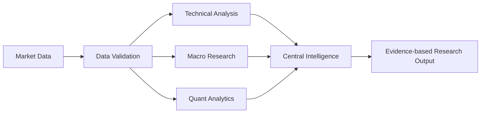

<div align="center">


# MARKET-MIND-AI

### Open-source • Node-based • Multi-asset market intelligence

A visual research environment where specialist analytical workers connect as reusable nodes, execute directed workflows, and produce traceable research outputs.

[Four-Market Architecture](docs/FOUR-MARKET-PLATFORM.md) · [Architecture](docs/ARCHITECTURE.md) · [Workflow Guide](docs/WORKFLOW-GUIDE.md) · [Market Coverage](docs/MARKET-COVERAGE.md) · [Roadmap](docs/ROADMAP.md) · [Development Guide](docs/DEVELOPMENT.md) · [Private Deployment](docs/PRODUCTION-DEPLOYMENT.md) · [FreeLLMAPI Setup](docs/FREELLMAPI-INTEGRATION.md) · [Open-Source Research Skill](.agents/skills/quant-research-evaluation/SKILL.md) · [PyneCore indicator cross-check](docs/PYNECORE-RESEARCH.md) · [300 Research Skills](.agents/skills/market-mind-300-research-skills/SKILL.md)

</div>

---

## Overview

MARKET-MIND-AI is an open-source financial research terminal inspired by professional market-data workstations and visual node editors. Its core interaction model is a connected graph: data sources, validation steps, analytical workers, quantitative methods, and research outputs are composed into reusable workflows.

The platform is designed for research across four primary market groups: India, US, crypto and forex, with shared multi-asset infrastructure for equities, ETFs, indices, commodities, fixed income and macroeconomic series. Actual coverage depends on configured providers, venue permissions and licensing terms. See the [four-market implementation blueprint](docs/FOUR-MARKET-PLATFORM.md).

> **Preview notice:** The image above is a conceptual product illustration showing the intended terminal direction. It is not a screenshot of a fully implemented production application and does not display live market data.

## Product principles

- **Composable intelligence:** specialist workers connect through explicit input/output contracts.
- **One central intelligence core:** workers are analytical modules, not hundreds of separate language models.
- **Evidence-first outputs:** calculations, source timestamps, data quality, caveats, and method versions should be inspectable.
- **Deterministic analytics:** numerical calculations are performed by tested code; language models may explain, summarize, and route research.
- **Governed improvement:** worker changes are tested, versioned, reviewed, and reversible.
- **Provider-neutral data layer:** connectors are modular and must respect provider terms, licences, rate limits, and redistribution rules.
- **Synthetic data is labelled:** the sample endpoint is a deterministic development fixture, never a live or historical price feed.
- **Research only:** no paper trading, brokerage credentials, order routing, or automated execution.

## Historical data and forecasting research (educational)

The repository includes a best-effort Yahoo Finance historical-data adapter and
chronological forecasting benchmarks. This is research—not a trading system,
recommendation, or evidence of profitability.

Run locally from the repository root:

```bash
cd backend
python -m pip install -r requirements.txt
# Single chronological train/validation/test holdout
python run_historical_research.py --symbol AAPL --bars 750
# Expanding-window walk-forward benchmark
python run_historical_research.py --symbol RELIANCE.NS --bars 1500 --walk-forward \
  --min-train-samples 100 --test-window-size 20 --step-size 20
```

The CLI fetches daily OHLCV, prefers adjusted close when available, and records
the source, retrieval time, date range, and SHA-256 fingerprint of the fetched
bars. It compares lagged-return ridge regression with zero-return and
pre-test constant-mean baselines. In walk-forward mode, each window tunes ridge
alpha using only a validation slice from that window's pre-test history, refits
on all pre-test samples, and evaluates the next unseen test segment. The
expanding history and test-window timestamps are included in the JSON report.

Walk-forward output includes individual window metrics and arithmetic mean
window-level metrics; these are not pooled-observation metrics. Test windows
are non-overlapping by default, but can overlap when `--step-size` is smaller
than `--test-window-size`. The routine does not shuffle time-series rows or
use test data for model selection. These comparisons are descriptive only and
do not establish predictive skill or a tradable edge.

**Important:** Yahoo's chart endpoint is unofficial and provider-dependent.
Check data licensing and availability. Results can vary by symbol, period,
adjustments, and provider corrections. The experiment models one symbol and
one-day log returns only; it omits costs, slippage, taxes, portfolio risk, and
execution. A good historical score is not a guarantee of future performance.
No real-money trading, order routing, or brokerage integration is included.

## Inception Labs Mercury shared intelligence provider

The shared intelligence core defaults to **Inception Labs Mercury-3** through the official chat-completions API. Configure `INCEPTION_API_KEY` as a backend-only secret and set `INTELLIGENCE_CORE_ENABLED=true`; see [Mercury provider setup](docs/FREELLMAPI-INTEGRATION.md) and [`backend/.env.example`](backend/.env.example). Never commit provider keys or expose them in frontend code. The provider synthesizes supplied research only; it does not fetch market data or execute trades.

A legacy FreeLLMAPI adapter remains available when explicitly selected.

## Research draft quality checks

A deterministic structural evaluator is available in
`backend/app/research_quality_eval.py`. It measures whether draft claims carry
source identifiers that match a supplied source registry, flags unknown IDs,
and can compare those coverage metrics with an explicitly supplied baseline.
It does **not** check whether sources are authentic or entail the claims, and
it does not measure forecast accuracy or market performance. Treat its metrics
as traceability diagnostics—not a truth score or an intelligence benchmark.

API usage:
- `POST /api/research/quality-evaluate` — run the evaluator on a supplied draft, claims, and source registry.
- When a queued task includes structured `draft`, `claims`, and `source_registry` metadata, its evaluation is stored separately in SQLite and linked to the task ID.
- `GET /api/analytical-agent-tasks/{task_id}/quality-evaluation` — retrieve the persisted evaluation. Returns `not_evaluated` for a known task without an evaluation and 404 for an unknown task.

Evaluation persistence is idempotent per task (one current evaluation record per task); it is not an immutable evaluation history or model-training feedback.

## Routed specialist research tasks

The research API now supports a single brief being routed to matched specialist
profiles and persisted as individual research tasks:

- `POST /api/research/specialist-routing` — preview deterministic keyword matches.
- `POST /api/research/route-and-queue` — route and queue matched specialist tasks.

Example request:

```json
{
  "brief": "Compare historical volatility and data quality across supplied instruments",
  "data": {"observations": []},
  "max_specialists": 3
}
```

The response includes the routing explanation and task IDs. Each task is persisted
in SQLite and scheduled through FastAPI's process-local background task mechanism.
This is **not** a durable distributed queue: a process restart can interrupt
execution, and recovery remains explicit. Selected specialists share one configured
inference provider; routing is keyword matching, not semantic LLM reasoning.
Only supplied data is used. No live market feed or trade execution is involved.

## Cross-market collaboration API

- `GET /api/agent-network` — inspect the four-market research mesh.
- `POST /api/agent-network/messages` — publish structured, source-linked research notes.
- `GET /api/agent-network/messages` — read shared notes across markets or filter by market/topic.
- `GET /api/agent-network/brief` — build a deterministic cross-market roundtable with per-market coverage, quality labels and comparable structured findings.

Specialist modules exchange deterministic records; per-agent brain-context and learning-governance scaffolding is implemented, but independent autonomous cloud agents and self-training are not yet active. No live feeds or trading execution. See [four-market architecture](docs/FOUR-MARKET-PLATFORM.md).

## Current implementation

| Area | Current state |
|---|---|
| React + TypeScript terminal shell | Implemented |
| React Flow node graph | Implemented |
| Node library and worker catalogue UI | Implemented |
| FastAPI service and health endpoint | Implemented |
| DAG workflow execution and cycle detection | Implemented |
| Data, SMA, EMA, RSI, MACD, Bollinger, returns, volatility and summary nodes | Implemented |
| 550 AI analytical worker profiles / 20 departments | Shared central intelligence; supported workflow nodes are routed to deterministic handlers; profiles are not 550 separate models or active runtime processes |
| Cross-market research agent message bus | Added; deterministic shared mesh across India, US, crypto and forex; no model inference or live feeds |
| Shared-core specialist worker routing | Added; workflow nodes map to validated worker profiles and deterministic handlers, with assignment metadata and runtime capability endpoint; no LLM inference or autonomous learning |
| 550+ analytical agent brain contexts | Added distinct worker-specific role prompts, specialization, memory namespaces and brain-context hashes; agents share the configured inference provider rather than running 550 separate models |
| Agent learning lifecycle | Added worker-scoped evaluated-feedback records and update proposals; proposals require review, tests and rollback planning; no automatic model-weight training or auto-application |
| Agent cloud workspace | Not yet implemented; persistent local SQLite memory exists, but cloud-hosted autonomous agents, scheduler and remote workspaces remain future work |
| Worker-scoped evidence memory | Added; append-only SQLite notes per registered worker with source references, quality labels, bounded JSON validation and read filters; not autonomous learning or executable instructions |
| Versioned specialist-worker contracts | Added v1.0.0 input/output shape contracts and evidence requirements for all 10 workflow node types; execution validates contract shapes before and after deterministic handlers |
| Versioned 550-worker registry | Added registry v1.0.0, SHA-256 profile manifest, department counts, and deterministic integrity evaluation endpoint; profiles remain templates coordinated by one core |
| Central research orchestrator | Added shared-core workflow coordination, worker-level result aggregation, contract-version references, a consolidated report and optional shared-core synthesis over the deterministic report; disabled by default, no market-data fetching or broker execution |\n| Shared intelligence-core provider boundary | Added optional loopback-only Ollama synthesis configuration, disabled by default, connected to the research orchestrator, with bounded input, timeout, explicit provider failure states and a status endpoint; numerical outputs remain deterministic and authoritative |
| Docker Compose development setup | Added |
| CI quality workflow | Added; run status visible in GitHub Actions |
| Market taxonomy and searchable instrument reference directory | Added |
| Configurable RSS news ingestion and terminal news panel | Added |
| SMA, EMA, RSI, MACD, Bollinger and realized-volatility library | Added |
| Async in-process event bus and latency architecture | Added |
| Normalized OHLCV contract, timezone validation, provider adapter protocol and synthetic fixture | Added |
| SQLite market-bar history with idempotent upserts and provenance retention | Added |
| User-defined educational setup geometry and risk/reward calculator | Added; no signal generation or execution |
| Deterministic descriptive chart report over stored OHLCV | Added; SMA, RSI, MACD, Bollinger, ATR, recent range references, rule-based candle labels and confirmed swing points |\n| Integrated deep research and OHLCV quality diagnostics | Added; per-timeframe chart research, duplicate/order/OHLC/volume checks, source/status counts and explicit diagnostic limitations |\n| Advanced market diagnostics | Added; relative volume, per-observation return volatility, descriptive volatility bands and historical close-to-close drawdown |\n| Cross-asset historical correlation | Added; Pearson correlation of timestamp-aligned close-to-close returns, paired sample counts and null handling for insufficient/constant series |\n| Historical price-level clusters | Added; repeated confirmed swing highs/lows grouped by configurable percentage tolerance and minimum touch count |\n| Historical market breadth | Added; timestamp-aligned advancing/declining/unchanged counts, percentages, net advances and symbol coverage |\n| Consolidated research dashboard | Added; timeframe summaries, data-quality counts, price-cluster counts, optional correlation and latest breadth summary |
| Interactive sample-series chart using Lightweight Charts | Added |
| Workflow diagrams and graph usage guide | Added |
| Unit tests for branching DAG execution and cycle rejection | Added |

## Shared agent skill playbooks

Ten upstream day-trader skill definitions are vendored under [`.agents/skills/day-trader-skill/`](.agents/skills/day-trader-skill/README.md). The 550+ AI analytical worker profiles carry department-based `skill_refs` so the orchestration layer can select relevant research guidance without injecting every playbook into every task. These are intended to be 550+ specialist **AI analytical agents** coordinated by one shared central intelligence core—not merely generic worker slots. Each agent has a distinct role, brain/context hash, scoped memory namespace, and task interface. Important current implementation boundary: the registry still stores agent profiles and the runtime exposes bounded task execution; it does **not** yet mean 550 independently running, continuously autonomous agent loops or 550 separate foundation models. Supported workflow node types now route through a validated specialist registry to existing deterministic Python handlers. LLM inference is disabled by default; optional local Ollama synthesis is restricted to summarizing supplied research and never changes deterministic calculations. Autonomous learning and brokerage execution remain disabled. Worker memory is an append-only evidence-note store; it does not train models, treat stored text as instructions, or independently verify claims. Skill references do not execute scripts or grant permissions. The broker/order-execution skill is excluded; the application remains research-only with no brokerage routing.

## Visual workflow model



Workers are intended to be independently inspectable and reusable. The graph engine executes supported nodes in topological order and rejects cyclic or unsupported workflows.

## System flow diagrams

### End-to-end research pipeline


### Specialist worker network


### Low-latency engineering model


More detail: [workflow guide](docs/WORKFLOW-GUIDE.md), [low-latency architecture](docs/LOW-LATENCY-ARCHITECTURE.md), and [algorithm catalogue](docs/ALGORITHMS.md).

## Run locally

### Requirements

- Docker and Docker Compose, or
- Python 3.11+ and Node.js 20+

### Docker Compose

```bash
git clone https://github.com/djny45/-MARKET-MIND-AI.git
cd ./-MARKET-MIND-AI
docker compose up --build
```

Open:
- **Terminal:** http://localhost:5173
- **API documentation:** http://localhost:8000/docs
- **Health check:** http://localhost:8000/api/health

For manual setup, see [docs/DEVELOPMENT.md](docs/DEVELOPMENT.md).

## API surface

| Method | Endpoint | Purpose |
|---|---|---|
| GET | `/api/health` | Service health and execution boundary |
| GET | `/api/worker-runtime` | Specialist worker routing coverage and explicit inference/execution capability status |\n| GET | `/api/intelligence-core` | Shared-core provider configuration status; no model is loaded or contacted |
| POST | `/api/workers/{worker_id}/memory` | Append a bounded, provenance-labelled research note to a registered worker |
| GET | `/api/workers/{worker_id}/memory` | Read worker-scoped notes with optional type and limit filters |
| GET | `/api/ready` | SQLite dependency readiness; HTTP 503 when unavailable |
| GET | `/api/providers/status` | Implemented adapter availability; distinguishes synthetic fixture from live providers |
| GET | `/api/audit/events` | Recent market-data ingestion audit events |
| GET | `/api/market-data/lineage` | Stored observation counts and timestamp ranges by source and status |
| GET | `/api/market-data/overview` | Local stored symbol/timeframe coverage summary |
| GET | `/api/watchlist` | List locally saved instrument symbols |
| POST | `/api/watchlist` | Add an instrument symbol to the local watchlist |
| DELETE | `/api/watchlist/{symbol}` | Remove an instrument from the local watchlist |
| GET | `/api/nodes` | Supported workflow node definitions |
| GET | `/api/workers` | Worker profile catalogue |
| GET | `/api/instruments?q=` | Search curated instrument examples by market group and asset class |\n| GET | `/api/instrument-master` | Search persistent four-market instrument reference metadata |\n| POST | `/api/instrument-master/identifiers` | Register provider-native identifiers against canonical instrument IDs |
| GET | `/api/news` | Fetch configured official RSS headlines |
| POST | `/api/news/ingest` | Trigger RSS ingestion |
| POST | `/api/indicators` | Calculate deterministic indicator series |
| POST | `/api/research/setup` | Calculate hypothetical entry/stop/target geometry and risk/reward from user-supplied levels |
| POST | `/api/analytics/performance` | Historical return, drawdown, volatility, Sharpe, Sortino and optional benchmark statistics |
| GET | `/api/market-data/sample` | Explicitly synthetic OHLCV fixture for UI and integration tests |
| POST | `/api/market-data/store` | Store normalized bars with source, status and retrieval metadata |\n| POST | `/api/market-data/events` | Import validated historical trades, quotes, order-book snapshots, open interest, funding and FX reference events |\n| GET | `/api/market-data/events` | Query historical microstructure events by instrument, event type, provider, venue and time range |
| GET | `/api/market-data/events/quality` | Diagnose historical event sequence, timestamp and order-book snapshot consistency |
| GET | `/api/market-data/history` | Retrieve stored bars with provenance metadata |
| GET | `/api/research/chart` | Single-timeframe descriptive report from stored bars |
| GET | `/api/research/timeframes` | Optional multi-timeframe comparison across stored 15m, 1h, 4h and 1d bars |
| GET | `/api/research/export` | Download provenance-preserving historical evidence JSON with SHA-256 integrity metadata |
| POST | `/api/research/compare-exports` | Compare two compatible historical evidence bundles |\n\nDeep terminal report (single or multi-timeframe):\n\n```bash\ncd backend\nPYTHONPATH=. python terminal_chart_report.py --symbol BTCUSD --mode single --interval 1h --limit 500 --deep\nPYTHONPATH=. python terminal_chart_report.py --symbol BTCUSD --mode multi --intervals 15m,1h,4h,1d --limit 500 --deep\nPYTHONPATH=. python terminal_chart_report.py --symbol BTCUSD --mode single --interval 1h --limit 500 --deep --correlate-symbols ETHUSD,SOLUSD\nPYTHONPATH=. python terminal_chart_report.py --symbol BTCUSD --mode single --interval 1h --limit 500 --deep --breadth-symbols ETHUSD,SOLUSD\n```\n\nThe deep report adds structural data-quality diagnostics, optional cross-asset correlation and market-breadth summaries from exact timestamp matches, and a consolidated `dashboard` summary. It does not infer freshness or missing exchange sessions without provider-specific schedules. See [deep analysis guide](docs/DEEP-ANALYSIS.md).
| POST | `/api/workflows/execute` | Execute a directed research graph |

## Repository structure

```text
.
├── .github/workflows/       # CI quality checks
├── backend/app/             # FastAPI and DAG execution engine
├── frontend/src/            # React terminal and graph editor
├── docs/                    # Architecture, roadmap, development guide
│   └── assets/              # Project visual assets
├── docker-compose.yml
└── README.md
```

## Roadmap

1. Harden graph contracts, validation, test coverage, and saved workflows.
2. Add licensed market-data adapters, symbol/reference-data services, and streaming status.
3. Build multi-panel charts, screeners, heatmaps, fundamentals, news, and macro workspaces.
4. Expand deterministic analytics and implement specialist workers with measurable evaluations.
5. Add central AI research orchestration, reviewed worker memory, audit trails, and production observability.

See the detailed [roadmap](docs/ROADMAP.md).

## Data and licensing

This repository does not include Bloomberg proprietary software, terminal code, market datasets, or proprietary content. Data adapters must use authorized sources and clearly label real-time, delayed, end-of-day, and historical data. A publicly accessible endpoint is not automatically licensed for commercial use or redistribution.

Third-party libraries must be reviewed for licence compatibility, attribution, security, and maintenance before adoption.

## Historical Stooq adapter

The optional Stooq connector is a **daily historical research adapter** (`backend/app/stooq_adapter.py`), not a live quote service. It normalizes CSV rows into validated OHLCV bars and drops malformed rows, including non-finite prices/volume and invalid OHLC envelopes. Provider responses can vary by symbol, access policy, and availability; an empty or rejected response is surfaced as an error rather than silently treated as a zero-price observation.

Before enabling it in a workflow:

- Confirm that the requested symbol is supported by the provider and that its data terms permit your intended use.
- Keep the batch status as `HISTORICAL` and preserve the source/retrieval timestamp.
- Do not describe Stooq data as real-time, execution-grade, or automatically licensed for redistribution.
- Run the adapter’s offline tests (they mock network access):

  ```bash
  cd backend
  PYTHONPATH=. python -m unittest tests.test_stooq_adapter -v
  ```

The adapter is best-effort. A successful parse verifies CSV normalization only; it does not validate provider coverage, market-session completeness, or licensing rights.

## Security

Do not commit API keys, tokens, broker credentials, or private datasets. Use environment variables or a managed secret store. Report security issues privately using [SECURITY.md](SECURITY.md).

## Disclaimer

MARKET-MIND-AI is a software and financial-information research project, not a broker, exchange, investment adviser, or execution platform. Outputs may be incomplete, delayed, or inaccurate and are not personalized investment recommendations. Historical analysis does not guarantee future results.

## Contributing

Contributions are welcome. Please read [CONTRIBUTING.md](CONTRIBUTING.md), open an issue for substantial changes, add tests, and document data-source and licence implications.

<div align="center">

**Built as an open-source research platform.**

</div>


## Research evidence export and verification

The Research dashboard can download a provenance-preserving JSON bundle from:

```text
GET /api/research/export?symbol=BTCUSD&interval=1h&limit=500
```

The bundle contains stored historical observations, source/status/retrieval metadata, timestamp and data-quality diagnostics, cross-source comparisons, and a descriptive event timeline. Schema version 1.1 includes a SHA-256 integrity digest over the canonical bundle (excluding the digest field).

Verify a downloaded file from the repository root:

```bash
PYTHONPATH=backend python backend/verify_research_export.py ./BTCUSD-1h-research-evidence.json
```

To also save a detached verification report:

```bash
PYTHONPATH=backend python backend/verify_research_export.py ./BTCUSD-1h-research-evidence.json --report ./BTCUSD-verification.json
```

The detached report records the verification time, filename, byte size, exact-file SHA-256, and pass/fail result. A matching digest detects accidental changes relative to the embedded digest; it is not a digital signature and does not authenticate the source provider. These tools operate on historical research evidence only. Brokerage execution remains disabled.


Batch verification of several exports is also supported:

```bash
PYTHONPATH=backend python backend/verify_research_export.py ./BTCUSD-1h-research-evidence.json ./ETHUSD-1h-research-evidence.json --batch-report ./batch-verification.json
```

The consolidated report records per-file hashes and results plus aggregate valid/invalid counts. The command returns success only when all supplied files verify.


Compare two downloaded evidence exports using the API or local CLI:

```bash
cd backend
PYTHONPATH=. python compare_research_exports.py ./before.json ./after.json --report ./comparison.json
```

The comparison reports added, removed and changed observations, per-observation provenance changes, diagnostic differences and embedded digest values. Matching uses exact timestamp strings and source labels.

For automation, add `--strict` to return exit code **1** unless the comparison status is `integrity_verified`; malformed inputs or I/O errors return **2**. The report is still printed and optionally written when strict validation returns 1:

```bash
PYTHONPATH=. python compare_research_exports.py ./before.json ./after.json --report ./comparison.json --strict
```

**Integrity limitation:** the SHA-256 digest detects changes relative to the stored digest, but it is not a digital signature and does not authenticate who produced the export. A party able to edit the bundle can recompute its digest. Treat `integrity_verified` as a consistency check—not proof of source authenticity, market-data accuracy, or investment performance.

See [deep analysis guide](docs/DEEP-ANALYSIS.md).


### Verified SQLite backup

From `backend`, create and verify a database backup with:

```bash
PYTHONPATH=. python backup_database.py ./backups/market_mind.sqlite
```

The utility validates source and backup integrity and refuses to overwrite an existing backup unless `--overwrite` is specified. See [development guide](docs/DEVELOPMENT.md) for operational limitations.


## Latest verified CI run

The GitHub Actions quality workflow completed successfully for commit `f7642cd1ce83b4c91ef19c26fdfa59733944fdaf` (3 November 2026):

- Backend: passed.
- Frontend: passed.
- Container build and smoke test: passed.
- Dependency audit: passed.

[View the successful GitHub Actions run](https://github.com/djny45/-MARKET-MIND-AI/actions/runs/41621173501).

This verifies the checks defined in the workflow at that commit; it is not a live deployment test or a market-data provider connectivity test. Provider access remains best-effort and broker execution remains disabled.


- `GET /api/market-data/trade-flow` — historical trade volume/delta buckets with side-coverage diagnostics; CVD is withheld when any sampled trade has unknown side.


- `GET /api/research/cross-market-correlation?symbols=india:nse:RELIANCE,us:nasdaq:AAPL&interval=1d&limit=500&min_observations=20` — descriptive pairwise Pearson correlation of close-to-close returns on exact shared UTC timestamps. No forward-fill is applied; insufficient samples and zero-variance series return a null coefficient. See [four-market platform guide](docs/FOUR-MARKET-PLATFORM.md).

Cross-market correlation is historical research only. Market sessions differ, so overlap may be sparse; correlations are not causal or predictive and are not trading signals. Synthetic observations remain explicitly labelled.


## Human review gate for model synthesis

Optional shared-core synthesis is an **untrusted draft**, not authoritative research. The prototype review endpoint `POST /api/research/synthesis/review` accepts a draft, structured claims, a supplied source registry, and an explicit `approve` or `reject` decision. Approval is blocked when claims lack source IDs or cite IDs absent from the supplied registry. Review decisions are appended to SQLite as immutable records with generated review IDs. The supplied reviewer field is only a claimed identity—not authenticated. Persistence does not verify source authenticity or claim entailment, and does not authorize investment decisions. Keep this endpoint behind trusted local access; authentication and authorization are mandatory before public deployment.

Example payload:

```json
{
  "draft": "Draft summary text",
  "claims": [{"text": "Claim wording", "source_refs": ["source-1"]}],
  "source_registry": [{"source_id": "source-1", "title": "Imported source"}],
  "decision": "approve",
  "reviewer": "reviewer-id",
  "review_note": "Reviewed against the provided material"
}
```


## Per-agent research task lifecycle

Each of the 550 registered analytical workers can now submit a bounded research brief and retrieve its persisted task record. A queue endpoint is also available at `POST /api/analytical-agents/{worker_id}/tasks/queue`; it writes a task record with `queued` status, then hands execution to FastAPI `BackgroundTasks`. Retrieve task state using `GET /api/analytical-agent-tasks/{task_id}` or list by worker with `GET /api/analytical-agents/{worker_id}/tasks`.

**Queue limitation:** task metadata/results are stored in SQLite, but execution dispatch is process-local FastAPI background work—not a durable external queue. On backend startup, stale `running` tasks are automatically requeued after a 15-minute grace period (best-effort); set `MARKET_MIND_STARTUP_RECOVERY=false` to disable this. The manual recovery endpoint `POST /api/analytical-agent-tasks/recover` remains available. Each task now persists an `execution_attempts` counter that increments only when the atomic queued-to-running claim succeeds; this helps distinguish queued/recovered tasks from actual execution attempts. Failed tasks also store a conservative failure classification (`transient_candidate` or `non_transient_candidate`) and a retry-review recommendation. Classification is advisory only: automatic retries remain disabled, and operators should inspect the failure before retrying. The `agent_task_performance` summary also reports persisted execution-attempt totals, average attempts per task, and failure-class counts alongside completion/failure rates. These are historical task reliability indicators, not agent intelligence rankings. When structured claim/source evaluation is available, completed tasks can also write a metrics-only `validation_result` memory candidate linked to the task ID. It is marked `partial` and `review_required`; it does not store model conclusions as verified facts, train weights, alter strategy, or auto-promote lessons. Memory persistence is best-effort and cannot fail the completed research task. Candidate review is an explicit append-only operator action: `POST /api/workers/{worker_id}/memory/{memory_id}/review` with `decision` (`approved`, `rejected`, or `needs_revision`), `reviewer`, and optional `rationale`. The review is stored as a separate `validation_result` record linked to the candidate; it does not edit the candidate or activate it in model context. This endpoint is a prototype and must remain behind trusted local access until authentication/authorization is implemented. `GET /api/workers/{worker_id}/learning-candidates?limit=50` returns candidate summaries with the latest decision and bounded review history (up to 2,000 recent validation records scanned). `GET /api/workers/{worker_id}/learning-candidates/approved-context?query=...&limit=5` retrieves only candidates whose latest review is `approved`, using keyword overlap. It is explicit evidence retrieval—not automatic model-context injection or training—and scans only the newest 200 candidates. It can now be evaluated against supplied current metrics with `POST /api/workers/{worker_id}/learning-feedback/evaluate`, using a JSON body such as `{"current_metrics":{"claim_reference_coverage":0.95,"unknown_source_id_count":1},"stale_after_days":30,"tolerance":0.0001}`. The evaluator compares matching numeric metric names against up to 200 recent candidates whose latest review is approved, reports numeric deltas and age flags, and never infers whether an increase is good. Differences are review cues—not truth checks, autonomous learning, strategy changes, or model training.

Generated improvement proposals can now be reviewed through append-only records:
- `GET /api/workers/{worker_id}/improvement-proposals?limit=50` — list proposals and latest review state.
- `POST /api/workers/{worker_id}/improvement-proposals/{proposal_memory_id}/review` — append a decision: `approved_for_staging`, `rejected`, or `needs_revision`, plus reviewer and rationale.

`approved_for_staging` means only that an operator permits further isolated staging evaluation. It does not merge code, alter prompts or strategies, deploy, train a model, or enable live trading. Review history is append-only; the latest decision controls the displayed status. Recovery does **not** dispatch queued tasks automatically; explicit bounded dispatch is still required. Distributed/multi-instance coordination, automatic retry/backoff, and a cloud scheduler remain unimplemented. Startup recovery is intended for a single API process sharing the SQLite database; do not describe this as 550 always-on agents.

- `POST /api/analytical-agents/{worker_id}/tasks` — accepts a short brief and optional supplied JSON data; runs synchronously through the shared core when configured.
- `GET /api/analytical-agents/{worker_id}/tasks?limit=20` — lists that worker's task history.
- `GET /api/analytical-agent-tasks/{task_id}` — retrieves the stored input, status, result, and brain-context digest.

Tasks are isolated by worker ID and retain the worker context hash. The first implementation is **bounded and synchronous**: it does not yet provide cloud workspaces, background scheduling, or 550 always-on autonomous processes. If the shared Ollama core is not configured, the result explicitly reports that synthesis is unavailable rather than fabricating analysis. Tasks use supplied data only; live market retrieval, broker execution, and paper trading are excluded.


## Human-reviewed staging experiment records

Improvement proposals can now be followed by metrics-only staging experiment records:

- `POST /api/workers/{worker_id}/improvement-proposals/{proposal_memory_id}/staging-experiments` — append a baseline/candidate comparison.
- `GET /api/workers/{worker_id}/staging-experiments` — list recent experiment records.

The POST endpoint requires the proposal's **latest** review to be `approved_for_staging`; a later `rejected` or `needs_revision` review revokes that gate. Inputs are reviewer-supplied benchmark identifiers and numeric metrics, stored as append-only worker memory. Metric direction is deliberately not assumed (higher is not always better), so non-identical comparisons remain `inconclusive`; identical metrics are labeled `no_material_change`.

This is a **recording and governance layer**, not a benchmark execution engine. It does not run proposal code, alter production settings, modify prompts or model weights, deploy, or trade. The metrics are unverified unless independently evaluated. See `backend/app/staging_experiments.py` and `backend/tests/test_staging_experiments.py`.


A reproducible fixture-based route is also available:

- `POST /api/workers/{worker_id}/improvement-proposals/{proposal_memory_id}/staging-benchmark` — run the existing deterministic traceability benchmark against separate baseline and candidate fixture sets, then persist both benchmark fingerprints and aggregate metrics.

This route is still offline and fixture-only. It does not fetch market data or execute proposal code. The benchmark measures source-reference structure only; it is not a truth, forecasting, or trading-performance test.

The offline staging benchmark now also pairs baseline and candidate fixtures by exact `case_id`, stores per-case deltas for both traceability coverage metrics, and flags case-level decreases. Mismatched case sets are rejected instead of comparing unrelated samples. These are structural regression diagnostics only; they do not assess truth, predictive ability, or trading performance.

### Whitelisted offline evaluator configuration

The fixture benchmark accepts an optional `quality_config` object with exactly one supported setting: `uncertainty_markers` (1–20 non-empty strings, each up to 80 characters). Unsupported keys are rejected. The normalized config is included in the benchmark fingerprint and returned with the result. The benchmark additionally reports `uncertainty_marker_coverage`, the share of fixture drafts containing at least one configured marker. This is a narrow text-checklist metric and can be gamed by wording; it is not a measure of genuine uncertainty calibration, factual quality, or predictive skill. This config does not change model weights, prompts, strategies, live data, production settings, or trading.

### Approved proposal → whitelisted evaluator config staging

A narrow config-evaluation endpoint now connects an already-approved proposal to an explicit, structured evaluator config patch:

- `POST /api/workers/{worker_id}/improvement-proposals/{proposal_memory_id}/staging-config-evaluation`
- Request fields: `baseline_cases`, `candidate_cases`, `config_patch`, `reviewer`, and optional `notes`.
- The proposal's latest review must be `approved_for_staging` **before evaluation begins**. A subsequent review can revoke permission.
- `config_patch` is passed as a structured object to the benchmark's whitelist. At present, only `uncertainty_markers` is supported; unknown keys or malformed markers are rejected.
- Baseline fixtures use the default evaluator config; candidate fixtures use the validated patch. Baseline/candidate case IDs must match exactly.
- The append-only record stores the normalized config patch, both benchmark fingerprints, and paired metric diagnostics.

This endpoint does **not** translate proposal prose into settings, execute code from a proposal, or apply configuration to the running agent. The uncertainty-marker metric is a shallow text indicator, not real uncertainty calibration or model learning. This remains offline research evaluation only—no live market data, model-weight updates, deployment, or trades.

### Staging quality gate (review aid, not approval)

The staging config-evaluation record now includes a deterministic quality gate:

- Any aggregate decrease **or any paired case-level decrease** in the two traceability coverage metrics → `blocked_regression`. A positive aggregate cannot mask a regression on an individual fixture.
- No metric decrease and at least one aggregate increase meeting `min_improvement` (default `0.01`) → `eligible_for_human_staging_review`.
- Otherwise → `no_meaningful_improvement`.
- `min_improvement` must be finite and in `(0, 1]`.

This is a fixture-based eligibility signal only. **It never auto-approves, merges, deploys, trains, or trades.** Human review remains required, and coverage gains do not establish truth or market performance.

### Staging experiment history summary

A descriptive history endpoint is available:

- `GET /api/workers/{worker_id}/staging-experiments/summary?limit=100`

It summarizes recent stored fixture experiments by proposal, quality-gate status, metric delta ranges/means, and evaluator config patch frequency. It is a descriptive record only: it does not infer statistical significance, causality, market skill, or strategy rankings. The source records remain append-only and reviewer-controlled.

### Repeatability summary for staging experiments

- `GET /api/workers/{worker_id}/staging-experiments/repeatability?limit=200&min_trials=3`

Groups recorded fixture evaluations by proposal, exact baseline/candidate benchmark fingerprints, and canonicalized evaluator configuration. Groups below the minimum trial count are not presented as repeatability evidence. For eligible groups, the response reports gate-status counts and per-metric positive/negative/zero delta counts.

This is a descriptive consistency check, not statistical significance or independent-data validation. Reusing identical fixtures can reproduce the same bias; it does not establish real-world market skill. No code, model weights, production configuration, or trading behavior is changed.
