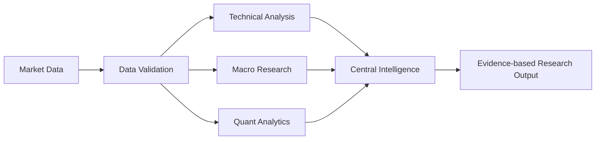

<div align="center">


# MARKET-MIND-AI

### Open-source • Node-based • Multi-asset market intelligence

A visual research environment where specialist analytical workers connect as reusable nodes, execute directed workflows, and produce traceable research outputs.

[Architecture](docs/ARCHITECTURE.md) · [Workflow Guide](docs/WORKFLOW-GUIDE.md) · [Market Coverage](docs/MARKET-COVERAGE.md) · [Roadmap](docs/ROADMAP.md) · [Development Guide](docs/DEVELOPMENT.md)

</div>

---

## Overview

MARKET-MIND-AI is an open-source financial research terminal inspired by professional market-data workstations and visual node editors. Its core interaction model is a connected graph: data sources, validation steps, analytical workers, quantitative methods, and research outputs are composed into reusable workflows.

The platform is designed for multi-asset research across equities, ETFs, indices, foreign exchange, commodities, fixed income, and digital assets, subject to each data provider's capabilities and licensing terms.

> **Preview notice:** The image above is a conceptual product illustration showing the intended terminal direction. It is not a screenshot of a fully implemented production application and does not display live market data.

## Product principles

- **Composable intelligence:** specialist workers connect through explicit input/output contracts.
- **One central intelligence core:** workers are analytical modules, not hundreds of separate language models.
- **Evidence-first outputs:** calculations, source timestamps, data quality, caveats, and method versions should be inspectable.
- **Deterministic analytics:** numerical calculations are performed by tested code; language models may explain, summarize, and route research.
- **Governed improvement:** worker changes are tested, versioned, reviewed, and reversible.
- **Provider-neutral data layer:** connectors are modular and must respect provider terms, licences, rate limits, and redistribution rules.
- **Research only:** no paper trading, brokerage credentials, order routing, or automated execution.

## Current implementation

| Area | Current state |
|---|---|
| React + TypeScript terminal shell | Implemented |
| React Flow node graph | Implemented |
| Node library and worker catalogue UI | Implemented |
| FastAPI service and health endpoint | Implemented |
| DAG workflow execution and cycle detection | Implemented |
| Data, SMA, EMA, RSI, MACD, Bollinger, returns, volatility and summary nodes | Implemented |
| 550 worker profiles / 20 departments | Generated templates; not 550 completed agents |
| Docker Compose development setup | Added |
| CI quality workflow | Added; run status visible in GitHub Actions |
| Market taxonomy and provider capability registry | Added |
| Configurable RSS news ingestion | Added |
| SMA, EMA, RSI, MACD, Bollinger and realized-volatility library | Added |
| Async in-process event bus and latency architecture | Added |\n| Workflow diagrams and graph usage guide | Added |\n| Unit tests for branching DAG execution and cycle rejection | Added |

## Visual workflow model



Workers are intended to be independently inspectable and reusable. The graph engine executes supported nodes in topological order and rejects cyclic or unsupported workflows.

## System flow diagrams\n\n### End-to-end research pipeline\n\n\n\n### Specialist worker network\n\n\n\n### Low-latency engineering model\n\n\n\nMore detail: [workflow guide](docs/WORKFLOW-GUIDE.md), [low-latency architecture](docs/LOW-LATENCY-ARCHITECTURE.md), and [algorithm catalogue](docs/ALGORITHMS.md).\n\n## Run locally

### Requirements

- Docker and Docker Compose, or
- Python 3.11+ and Node.js 20+

### Docker Compose

```bash
git clone https://github.com/djny45/-MARKET-MIND-AI.git
cd -MARKET-MIND-AI
docker compose up --build
```

Open:
- **Terminal:** http://localhost:5173
- **API documentation:** http://localhost:8000/docs
- **Health check:** http://localhost:8000/api/health

For manual setup, see [docs/DEVELOPMENT.md](docs/DEVELOPMENT.md).

## API surface

| Method | Endpoint | Purpose |
|---|---|---|
| GET | `/api/health` | Service health and execution boundary |
| GET | `/api/nodes` | Supported workflow node definitions |
| GET | `/api/workers` | Worker profile catalogue |
| POST | `/api/workflows/execute` | Execute a directed research graph |

## Repository structure

```text
.
├── .github/workflows/       # CI quality checks
├── backend/app/             # FastAPI and DAG execution engine
├── frontend/src/            # React terminal and graph editor
├── docs/                    # Architecture, roadmap, development guide
│   └── assets/              # Project visual assets
├── docker-compose.yml
└── README.md
```

## Roadmap

1. Harden graph contracts, validation, test coverage, and saved workflows.
2. Add licensed market-data adapters, symbol/reference-data services, and streaming status.
3. Build multi-panel charts, screeners, heatmaps, fundamentals, news, and macro workspaces.
4. Expand deterministic analytics and implement specialist workers with measurable evaluations.
5. Add central AI research orchestration, reviewed worker memory, audit trails, and production observability.

See the detailed [roadmap](docs/ROADMAP.md).

## Data and licensing

This repository does not include Bloomberg proprietary software, terminal code, market datasets, or proprietary content. Data adapters must use authorized sources and clearly label real-time, delayed, end-of-day, and historical data. A publicly accessible endpoint is not automatically licensed for commercial use or redistribution.

Third-party libraries must be reviewed for licence compatibility, attribution, security, and maintenance before adoption.

## Security

Do not commit API keys, tokens, broker credentials, or private datasets. Use environment variables or a managed secret store. Report security issues privately using [SECURITY.md](SECURITY.md).

## Disclaimer

MARKET-MIND-AI is a software and financial-information research project, not a broker, exchange, investment adviser, or execution platform. Outputs may be incomplete, delayed, or inaccurate and are not personalized investment recommendations. Historical analysis does not guarantee future results.

## Contributing

Contributions are welcome. Please read [CONTRIBUTING.md](CONTRIBUTING.md), open an issue for substantial changes, add tests, and document data-source and licence implications.

<div align="center">

**Built as an open-source research platform.**

</div>
