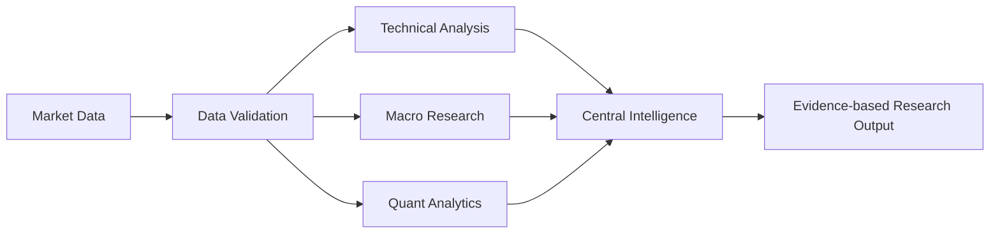
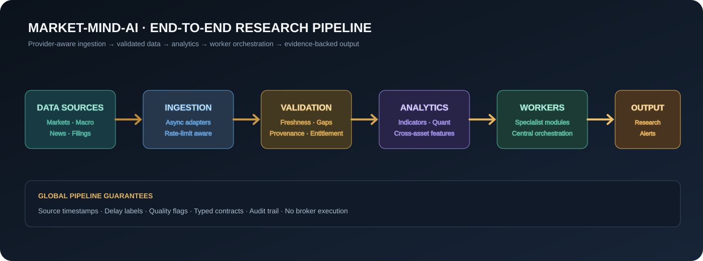

<div align="center">


# MARKET-MIND-AI

### Open-source • Node-based • Multi-asset market intelligence

A visual research environment where specialist analytical workers connect as reusable nodes, execute directed workflows, and produce traceable research outputs.

[Four-Market Architecture](docs/FOUR-MARKET-PLATFORM.md) · [Architecture](docs/ARCHITECTURE.md) · [Workflow Guide](docs/WORKFLOW-GUIDE.md) · [Market Coverage](docs/MARKET-COVERAGE.md) · [Roadmap](docs/ROADMAP.md) · [Development Guide](docs/DEVELOPMENT.md) · [Private Deployment](docs/PRODUCTION-DEPLOYMENT.md)

</div>

---

## Overview

MARKET-MIND-AI is an open-source financial research terminal inspired by professional market-data workstations and visual node editors. Its core interaction model is a connected graph: data sources, validation steps, analytical workers, quantitative methods, and research outputs are composed into reusable workflows.

The platform is designed for research across four primary market groups: India, US, crypto and forex, with shared multi-asset infrastructure for equities, ETFs, indices, commodities, fixed income and macroeconomic series. Actual coverage depends on configured providers, venue permissions and licensing terms. See the [four-market implementation blueprint](docs/FOUR-MARKET-PLATFORM.md).

> **Preview notice:** The image above is a conceptual product illustration showing the intended terminal direction. It is not a screenshot of a fully implemented production application and does not display live market data.

## Product principles

- **Composable intelligence:** specialist workers connect through explicit input/output contracts.
- **One central intelligence core:** workers are analytical modules, not hundreds of separate language models.
- **Evidence-first outputs:** calculations, source timestamps, data quality, caveats, and method versions should be inspectable.
- **Deterministic analytics:** numerical calculations are performed by tested code; language models may explain, summarize, and route research.
- **Governed improvement:** worker changes are tested, versioned, reviewed, and reversible.
- **Provider-neutral data layer:** connectors are modular and must respect provider terms, licences, rate limits, and redistribution rules.
- **Synthetic data is labelled:** the sample endpoint is a deterministic development fixture, never a live or historical price feed.
- **Research only:** no paper trading, brokerage credentials, order routing, or automated execution.

## Cross-market collaboration API

- `GET /api/agent-network` — inspect the four-market research mesh.
- `POST /api/agent-network/messages` — publish structured, source-linked research notes.
- `GET /api/agent-network/messages` — read shared notes across markets or filter by market/topic.
- `GET /api/agent-network/brief` — build a deterministic cross-market roundtable with per-market coverage, quality labels and comparable structured findings.

Specialist modules exchange deterministic records; this does not activate LLM agents, live feeds or trading execution. See [four-market architecture](docs/FOUR-MARKET-PLATFORM.md).

## Current implementation

| Area | Current state |
|---|---|
| React + TypeScript terminal shell | Implemented |
| React Flow node graph | Implemented |
| Node library and worker catalogue UI | Implemented |
| FastAPI service and health endpoint | Implemented |
| DAG workflow execution and cycle detection | Implemented |
| Data, SMA, EMA, RSI, MACD, Bollinger, returns, volatility and summary nodes | Implemented |
| 550 AI analytical worker profiles / 20 departments | Shared central intelligence; supported workflow nodes are routed to deterministic handlers; profiles are not 550 separate models or active runtime processes |
| Cross-market research agent message bus | Added; deterministic shared mesh across India, US, crypto and forex; no model inference or live feeds |
| Shared-core specialist worker routing | Added; workflow nodes map to validated worker profiles and deterministic handlers, with assignment metadata and runtime capability endpoint; no LLM inference or autonomous learning |
| Worker-scoped evidence memory | Added; append-only SQLite notes per registered worker with source references, quality labels, bounded JSON validation and read filters; not autonomous learning or executable instructions |
| Versioned specialist-worker contracts | Added v1.0.0 input/output shape contracts and evidence requirements for all 10 workflow node types; execution validates contract shapes before and after deterministic handlers |
| Versioned 550-worker registry | Added registry v1.0.0, SHA-256 profile manifest, department counts, and deterministic integrity evaluation endpoint; profiles remain templates coordinated by one core |
| Central research orchestrator | Added shared-core workflow coordination, worker-level result aggregation, contract-version references, a consolidated report and optional shared-core synthesis over the deterministic report; disabled by default, no market-data fetching or broker execution |\n| Shared intelligence-core provider boundary | Added optional loopback-only Ollama synthesis configuration, disabled by default, connected to the research orchestrator, with bounded input, timeout, explicit provider failure states and a status endpoint; numerical outputs remain deterministic and authoritative |
| Docker Compose development setup | Added |
| CI quality workflow | Added; run status visible in GitHub Actions |
| Market taxonomy and searchable instrument reference directory | Added |
| Configurable RSS news ingestion and terminal news panel | Added |
| SMA, EMA, RSI, MACD, Bollinger and realized-volatility library | Added |
| Async in-process event bus and latency architecture | Added |
| Normalized OHLCV contract, timezone validation, provider adapter protocol and synthetic fixture | Added |
| SQLite market-bar history with idempotent upserts and provenance retention | Added |
| User-defined educational setup geometry and risk/reward calculator | Added; no signal generation or execution |
| Deterministic descriptive chart report over stored OHLCV | Added; SMA, RSI, MACD, Bollinger, ATR, recent range references, rule-based candle labels and confirmed swing points |\n| Integrated deep research and OHLCV quality diagnostics | Added; per-timeframe chart research, duplicate/order/OHLC/volume checks, source/status counts and explicit diagnostic limitations |\n| Advanced market diagnostics | Added; relative volume, per-observation return volatility, descriptive volatility bands and historical close-to-close drawdown |\n| Cross-asset historical correlation | Added; Pearson correlation of timestamp-aligned close-to-close returns, paired sample counts and null handling for insufficient/constant series |\n| Historical price-level clusters | Added; repeated confirmed swing highs/lows grouped by configurable percentage tolerance and minimum touch count |\n| Historical market breadth | Added; timestamp-aligned advancing/declining/unchanged counts, percentages, net advances and symbol coverage |\n| Consolidated research dashboard | Added; timeframe summaries, data-quality counts, price-cluster counts, optional correlation and latest breadth summary |
| Interactive sample-series chart using Lightweight Charts | Added |
| Workflow diagrams and graph usage guide | Added |
| Unit tests for branching DAG execution and cycle rejection | Added |

## Shared agent skill playbooks

Ten upstream day-trader skill definitions are vendored under [`.agents/skills/day-trader-skill/`](.agents/skills/day-trader-skill/README.md). The 550+ AI analytical worker profiles carry department-based `skill_refs` so the orchestration layer can select relevant research guidance without injecting every playbook into every task. These profiles are AI analytical worker templates coordinated by one shared central intelligence core; they are not 550 separate models or 550 continuously running processes. Supported workflow node types now route through a validated specialist registry to existing deterministic Python handlers. LLM inference is disabled by default; optional local Ollama synthesis is restricted to summarizing supplied research and never changes deterministic calculations. Autonomous learning and brokerage execution remain disabled. Worker memory is an append-only evidence-note store; it does not train models, treat stored text as instructions, or independently verify claims. Skill references do not execute scripts or grant permissions. The broker/order-execution skill is excluded; the application remains research-only with no brokerage routing.

## Visual workflow model



Workers are intended to be independently inspectable and reusable. The graph engine executes supported nodes in topological order and rejects cyclic or unsupported workflows.

## System flow diagrams

### End-to-end research pipeline



### Specialist worker network


### Low-latency engineering model


More detail: [workflow guide](docs/WORKFLOW-GUIDE.md), [low-latency architecture](docs/LOW-LATENCY-ARCHITECTURE.md), and [algorithm catalogue](docs/ALGORITHMS.md).

## Run locally

### Requirements

- Docker and Docker Compose, or
- Python 3.11+ and Node.js 20+

### Docker Compose

```bash
git clone https://github.com/djny45/-MARKET-MIND-AI.git
cd ./-MARKET-MIND-AI
docker compose up --build
```

Open:
- **Terminal:** http://localhost:5173
- **API documentation:** http://localhost:8000/docs
- **Health check:** http://localhost:8000/api/health

For manual setup, see [docs/DEVELOPMENT.md](docs/DEVELOPMENT.md).

## API surface

| Method | Endpoint | Purpose |
|---|---|---|
| GET | `/api/health` | Service health and execution boundary |
| GET | `/api/worker-runtime` | Specialist worker routing coverage and explicit inference/execution capability status |\n| GET | `/api/intelligence-core` | Shared-core provider configuration status; no model is loaded or contacted |
| POST | `/api/workers/{worker_id}/memory` | Append a bounded, provenance-labelled research note to a registered worker |
| GET | `/api/workers/{worker_id}/memory` | Read worker-scoped notes with optional type and limit filters |
| GET | `/api/ready` | SQLite dependency readiness; HTTP 503 when unavailable |
| GET | `/api/providers/status` | Implemented adapter availability; distinguishes synthetic fixture from live providers |
| GET | `/api/audit/events` | Recent market-data ingestion audit events |
| GET | `/api/market-data/lineage` | Stored observation counts and timestamp ranges by source and status |
| GET | `/api/market-data/overview` | Local stored symbol/timeframe coverage summary |
| GET | `/api/watchlist` | List locally saved instrument symbols |
| POST | `/api/watchlist` | Add an instrument symbol to the local watchlist |
| DELETE | `/api/watchlist/{symbol}` | Remove an instrument from the local watchlist |
| GET | `/api/nodes` | Supported workflow node definitions |
| GET | `/api/workers` | Worker profile catalogue |
| GET | `/api/instruments?q=` | Search curated instrument examples by market group and asset class |\n| GET | `/api/instrument-master` | Search persistent four-market instrument reference metadata |\n| POST | `/api/instrument-master/identifiers` | Register provider-native identifiers against canonical instrument IDs |
| GET | `/api/news` | Fetch configured official RSS headlines |
| POST | `/api/news/ingest` | Trigger RSS ingestion |
| POST | `/api/indicators` | Calculate deterministic indicator series |
| POST | `/api/research/setup` | Calculate hypothetical entry/stop/target geometry and risk/reward from user-supplied levels |
| POST | `/api/analytics/performance` | Historical return, drawdown, volatility, Sharpe, Sortino and optional benchmark statistics |
| GET | `/api/market-data/sample` | Explicitly synthetic OHLCV fixture for UI and integration tests |
| POST | `/api/market-data/store` | Store normalized bars with source, status and retrieval metadata |\n| POST | `/api/market-data/events` | Import validated historical trades, quotes, order-book snapshots, open interest, funding and FX reference events |\n| GET | `/api/market-data/events` | Query historical microstructure events by instrument, event type, provider, venue and time range |
| GET | `/api/market-data/events/quality` | Diagnose historical event sequence, timestamp and order-book snapshot consistency |
| GET | `/api/market-data/history` | Retrieve stored bars with provenance metadata |
| GET | `/api/research/chart` | Single-timeframe descriptive report from stored bars |
| GET | `/api/research/timeframes` | Optional multi-timeframe comparison across stored 15m, 1h, 4h and 1d bars |
| GET | `/api/research/export` | Download provenance-preserving historical evidence JSON with SHA-256 integrity metadata |
| POST | `/api/research/compare-exports` | Compare two compatible historical evidence bundles |\n\nDeep terminal report (single or multi-timeframe):\n\n```bash\ncd backend\nPYTHONPATH=. python terminal_chart_report.py --symbol BTCUSD --mode single --interval 1h --limit 500 --deep\nPYTHONPATH=. python terminal_chart_report.py --symbol BTCUSD --mode multi --intervals 15m,1h,4h,1d --limit 500 --deep\nPYTHONPATH=. python terminal_chart_report.py --symbol BTCUSD --mode single --interval 1h --limit 500 --deep --correlate-symbols ETHUSD,SOLUSD\nPYTHONPATH=. python terminal_chart_report.py --symbol BTCUSD --mode single --interval 1h --limit 500 --deep --breadth-symbols ETHUSD,SOLUSD\n```\n\nThe deep report adds structural data-quality diagnostics, optional cross-asset correlation and market-breadth summaries from exact timestamp matches, and a consolidated `dashboard` summary. It does not infer freshness or missing exchange sessions without provider-specific schedules. See [deep analysis guide](docs/DEEP-ANALYSIS.md).
| POST | `/api/workflows/execute` | Execute a directed research graph |

## Repository structure

```text
.
├── .github/workflows/       # CI quality checks
├── backend/app/             # FastAPI and DAG execution engine
├── frontend/src/            # React terminal and graph editor
├── docs/                    # Architecture, roadmap, development guide
│   └── assets/              # Project visual assets
├── docker-compose.yml
└── README.md
```

## Roadmap

1. Harden graph contracts, validation, test coverage, and saved workflows.
2. Add licensed market-data adapters, symbol/reference-data services, and streaming status.
3. Build multi-panel charts, screeners, heatmaps, fundamentals, news, and macro workspaces.
4. Expand deterministic analytics and implement specialist workers with measurable evaluations.
5. Add central AI research orchestration, reviewed worker memory, audit trails, and production observability.

See the detailed [roadmap](docs/ROADMAP.md).

## Data and licensing

This repository does not include Bloomberg proprietary software, terminal code, market datasets, or proprietary content. Data adapters must use authorized sources and clearly label real-time, delayed, end-of-day, and historical data. A publicly accessible endpoint is not automatically licensed for commercial use or redistribution.

Third-party libraries must be reviewed for licence compatibility, attribution, security, and maintenance before adoption.

## Security

Do not commit API keys, tokens, broker credentials, or private datasets. Use environment variables or a managed secret store. Report security issues privately using [SECURITY.md](SECURITY.md).

## Disclaimer

MARKET-MIND-AI is a software and financial-information research project, not a broker, exchange, investment adviser, or execution platform. Outputs may be incomplete, delayed, or inaccurate and are not personalized investment recommendations. Historical analysis does not guarantee future results.

## Contributing

Contributions are welcome. Please read [CONTRIBUTING.md](CONTRIBUTING.md), open an issue for substantial changes, add tests, and document data-source and licence implications.

<div align="center">

**Built as an open-source research platform.**

</div>


## Research evidence export and verification

The Research dashboard can download a provenance-preserving JSON bundle from:

```text
GET /api/research/export?symbol=BTCUSD&interval=1h&limit=500
```

The bundle contains stored historical observations, source/status/retrieval metadata, timestamp and data-quality diagnostics, cross-source comparisons, and a descriptive event timeline. Schema version 1.1 includes a SHA-256 integrity digest over the canonical bundle (excluding the digest field).

Verify a downloaded file from the repository root:

```bash
PYTHONPATH=backend python backend/verify_research_export.py ./BTCUSD-1h-research-evidence.json
```

To also save a detached verification report:

```bash
PYTHONPATH=backend python backend/verify_research_export.py ./BTCUSD-1h-research-evidence.json --report ./BTCUSD-verification.json
```

The detached report records the verification time, filename, byte size, exact-file SHA-256, and pass/fail result. A matching digest detects accidental changes relative to the embedded digest; it is not a digital signature and does not authenticate the source provider. These tools operate on historical research evidence only. Brokerage execution remains disabled.


Batch verification of several exports is also supported:

```bash
PYTHONPATH=backend python backend/verify_research_export.py ./BTCUSD-1h-research-evidence.json ./ETHUSD-1h-research-evidence.json --batch-report ./batch-verification.json
```

The consolidated report records per-file hashes and results plus aggregate valid/invalid counts. The command returns success only when all supplied files verify.


Compare two downloaded evidence exports using the API or local CLI:

```bash
cd backend
PYTHONPATH=. python compare_research_exports.py ./before.json ./after.json --report ./comparison.json
```

The comparison reports added, removed and changed observations, per-observation provenance changes, diagnostic differences and embedded digest values. Matching uses exact timestamp strings and source labels. See [deep analysis guide](docs/DEEP-ANALYSIS.md).


### Verified SQLite backup

From `backend`, create and verify a database backup with:

```bash
PYTHONPATH=. python backup_database.py ./backups/market_mind.sqlite
```

The utility validates source and backup integrity and refuses to overwrite an existing backup unless `--overwrite` is specified. See [development guide](docs/DEVELOPMENT.md) for operational limitations.


## Latest verified CI run

The GitHub Actions quality workflow completed successfully for commit `55bd328faffc5815f0bc7a5c9fdacddf21ed3765` (31 October 2026):

- Backend: Python 3.12 compilation passed; **153 unit tests passed**; directed workflow smoke test passed.
- Frontend: Vite/TypeScript production build passed.
- Dependency audit: `pip-audit` and `npm audit --audit-level=high` passed.

[View the successful GitHub Actions run](https://github.com/djny45/-MARKET-MIND-AI/actions/runs/41232757766).

This verifies the checks defined in the workflow at that commit; it is not a live deployment test or a market-data provider connectivity test. The current provider status remains `no_live_provider_configured`, and broker execution remains disabled. Deployment smoke tests and authorized live/delayed data-provider integration remain release gates.


- `GET /api/market-data/trade-flow` — historical trade volume/delta buckets with side-coverage diagnostics; CVD is withheld when any sampled trade has unknown side.


- `GET /api/research/cross-market-correlation?symbols=india:nse:RELIANCE,us:nasdaq:AAPL&interval=1d&limit=500&min_observations=20` — descriptive pairwise Pearson correlation of close-to-close returns on exact shared UTC timestamps. No forward-fill is applied; insufficient samples and zero-variance series return a null coefficient. See [four-market platform guide](docs/FOUR-MARKET-PLATFORM.md).

Cross-market correlation is historical research only. Market sessions differ, so overlap may be sparse; correlations are not causal or predictive and are not trading signals. Synthetic observations remain explicitly labelled.


## Human review gate for model synthesis

Optional shared-core synthesis is an **untrusted draft**, not authoritative research. The prototype review endpoint `POST /api/research/synthesis/review` accepts a draft, structured claims, a supplied source registry, and an explicit `approve` or `reject` decision. Approval is blocked when claims lack source IDs or cite IDs absent from the supplied registry. The returned review record is stateless: it is not persisted, does not verify source authenticity or claim entailment, and does not authorize investment decisions. Keep this endpoint behind trusted local access; authentication and authorization are mandatory before public deployment.

Example payload:

```json
{
  "draft": "Draft summary text",
  "claims": [{"text": "Claim wording", "source_refs": ["source-1"]}],
  "source_registry": [{"source_id": "source-1", "title": "Imported source"}],
  "decision": "approve",
  "reviewer": "reviewer-id",
  "review_note": "Reviewed against the provided material"
}
```
