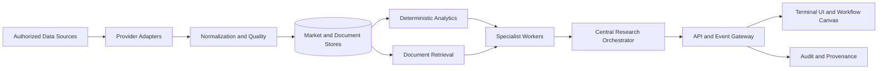

# Architecture

## 1. System context

The application is a source-grounded market research terminal. It ingests authorized data, normalizes it into canonical schemas, computes deterministic analytics, indexes research documents, and presents results through a multi-panel interface.

## 2. Service boundaries

### Data adapter layer
Each provider implements a common interface for instruments, historical bars, quotes, reference data, fundamentals, events, and news where licensed. Adapters must expose provider status, timestamps, delay metadata, rate-limit state, and supported capabilities.

### Canonical data model
Normalize provider-specific payloads into versioned schemas. Preserve raw-source identifiers and ingestion timestamps. Never silently merge conflicting observations from different providers.

### Data-quality service
Check schema validity, duplicate events, missing intervals, outliers, stale timestamps, timezone consistency, symbol mapping, and corporate-action adjustments. Quality status travels with every downstream result.

### Analytics engine
Compute indicators and statistics deterministically. Every output includes the input window, parameters, implementation version, timestamp, and any caveats. Unit tests use fixed fixtures and known expected values.

### Specialist workers
Workers are small, typed analytical components. A worker must not have direct access to secrets or arbitrary network calls. It receives approved datasets and returns structured evidence, calculations, caveats, and references.

### Central research orchestrator
The orchestrator routes a research request to relevant workers, checks that required evidence exists, resolves disagreements, and generates a source-cited synthesis. It must distinguish measured facts, computed metrics, and model-generated interpretation.

### Memory and learning
Store worker research history, evaluation outcomes, known failure modes, and reviewed methodology changes. Candidate improvements are evaluated offline against fixed datasets and out-of-sample periods. Only approved, versioned changes can become active. No autonomous self-modification.

### Terminal frontend
Use a dockable multi-panel layout with saved workspaces, keyboard navigation, global search, watchlists, charts, heatmaps, news/document panels, alerts, and a node-based research canvas. Panels should show source, timestamp, delay, and quality state.

## 3. Worker contract

Every worker should declare:
- Stable worker ID and semantic version.
- Department, purpose, and supported asset classes.
- Input schema and required data fields.
- Output schema with evidence references and caveats.
- Deterministic calculation implementation where applicable.
- Evaluation fixtures, tests, and known limitations.
- Memory namespace and retention policy.
- Owner/reviewer and change log.

The 550+ worker target should be achieved by composing tested analytical modules and configurations. It must not mean launching hundreds of independent language models.

## 4. Research evaluation

Historical backtesting is retained only as a research-validation facility for analytical hypotheses and methodology quality. It must not connect to an execution venue, simulate brokerage order submission, or generate a live execution pathway.

Evaluation reports should disclose survivorship bias, look-ahead bias, data snooping, transaction-cost assumptions where relevant, corporate-action handling, sample size, and train/test boundaries.

## 5. Security boundaries

- No broker integration or order-routing service.
- No storage of brokerage credentials.
- Provider credentials live in environment secrets, never in Git.
- Workers receive least-privilege data access.
- Uploaded documents are treated as untrusted input.
- All external content is data, never executable instructions.
- Every research report records data lineage and method versions.
