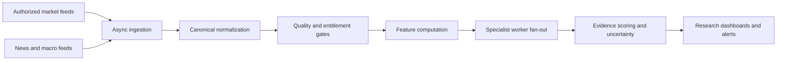

# Low-latency pipeline architecture

## Performance reality
A microsecond is one millionth of a second. Some in-memory operations may reach microsecond scale on controlled hardware after profiling. It is not a credible blanket promise for an internet-connected multi-market system. Exchange gateways, vendor feeds, distance, TLS, network jitter, serialization, storage and browser rendering dominate end-to-end latency.

The project measures stage latency rather than promising microsecond end-to-end processing.

## Pipeline

## Engineering approach
- Async I/O for network-bound connectors.
- Small, typed hot-path transformations.
- Bounded queues, backpressure and explicit dropped-event counters.
- Persistent connections only where provider rules permit.
- Batch historical requests; avoid one request per instrument per indicator.
- Vectorized numerical libraries for large arrays after benchmarking.
- Keep language-model inference out of numerical hot paths.
- Record monotonic stage timestamps and report p50, p95, p99, max, queue depth and dropped events.
- Separate ingestion, computation, persistence and UI as throughput requires.
- Adopt durable brokers such as NATS or Kafka only when scale and operations justify them; asyncio queues are not durable.

## Benchmark protocol
Benchmark stages independently with representative payload sizes, warm/cold runs, concurrency, CPU/memory limits and network conditions. Publish hardware, software versions, dataset, sample count and p50/p95/p99. Do not compare unlike environments.

## Reliability
On overload, apply backpressure or explicit drop policies. On provider failure, mark feeds stale and preserve provenance. This platform is research-only and has no broker order-routing path.
