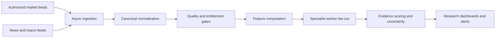

# Low-latency pipeline architecture

## Performance reality

A microsecond is one millionth of a second. Some in-memory operations may reach microsecond scale on controlled hardware after profiling. It is not a credible blanket promise for an internet-connected multi-market system. Exchange gateways, vendor feeds, distance, TLS, network jitter, serialization, storage, model inference and browser rendering dominate end-to-end latency.

The project measures stage latency rather than promising microsecond end-to-end processing.

## Pipeline

## Engineering approach

- Keep hot-path operations in-process and avoid unnecessary serialization.
- Use a bounded, non-blocking in-memory event queue for low-latency handoff; monitor dropped events and queue saturation.
- The EventBus exposes queue depth, capacity, high-water mark, event counters and rolling p50/p95/p99 queue-handoff latency in microseconds.
- Queue latency is measured with a monotonic process clock; it is not end-to-end latency and must not be compared across hosts.
- Async I/O for network-bound connectors.
- Small, typed hot-path transformations.
- Persistent connections only where provider rules permit.
- Batch historical requests; avoid one request per instrument per indicator.
- Vectorized numerical libraries for large arrays after benchmarking.
- Keep language-model inference out of numerical hot paths.
- Separate ingestion, computation, persistence and UI as throughput requires.
- Adopt durable brokers such as NATS or Kafka only when scale and operational requirements justify them; asyncio queues are not durable.

## Benchmark protocol

Benchmark stages independently with representative payload sizes, warm/cold runs, concurrency, CPU/memory limits and network conditions. Publish hardware, software versions, dataset, sample count and p50/p95/p99. Do not compare unlike environments. Run repeatable benchmarks before and after each optimization; never turn a benchmark target into a production latency guarantee.

## Reliability

On overload, the bounded queue drops new events and increments an explicit counter rather than blocking publishers indefinitely. Consumers and operators must treat dropped events as a data-integrity warning and reconcile from an authorized source before relying on affected research. On provider failure, mark feeds stale and preserve provenance. This platform is research-only and has no broker order-routing path.
